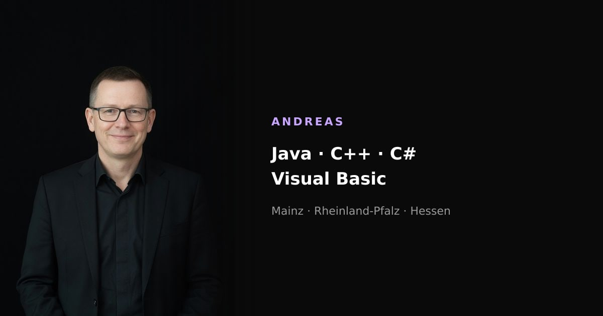

# Andreas

<p align="center">
  <a href="https://thewhitewitchtm.github.io/andreas/">
    
  </a>
</p>

<p align="center">
  <a href="https://thewhitewitchtm.github.io/andreas/"><strong>Open the site</strong></a><br>
  Freelance software from Mainz. Java, C++, C#, and Visual Basic. German and English.<br>
  <a href="https://thewhitewitchtm.github.io/mira/">Mira's World</a>
</p>

Static Next.js, TypeScript, Tailwind 4, shadcn. GitHub Pages serves the export at `/andreas/`.

## Develop

```bash
npm install
npm run dev
```

The dev server is at `http://localhost:3000`.

```bash
npm run build
```

`npm run build` writes `out/` with the `/andreas` base path, writes `.nojekyll`, and copies into `TheWhiteWitchTM.github.io/andreas/` when that repo sits next to this one. The copy merges Jekyll `include` names so Mira's export stays intact.

## Preview

This is a draft on GitHub Pages, for showing before it moves to his domain. Search engines are told not to index it. `lib/site.ts` still needs a family name, a street address with postal code, and an email or phone. Once those fields are set, the mail button and the full imprint appear on their own, and `app/robots.ts` plus `lib/metadata.ts` should allow indexing again.

The portrait is `public/andreas.jpg`. It was made from a description, in the black-backdrop style of Mira's portrait. Swap the file when a photograph is ready.
